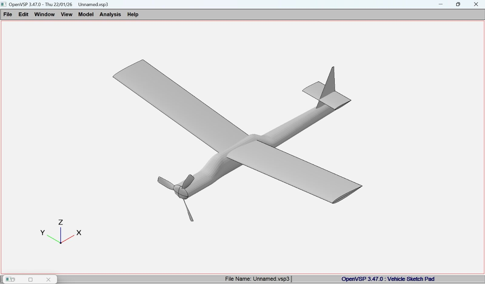
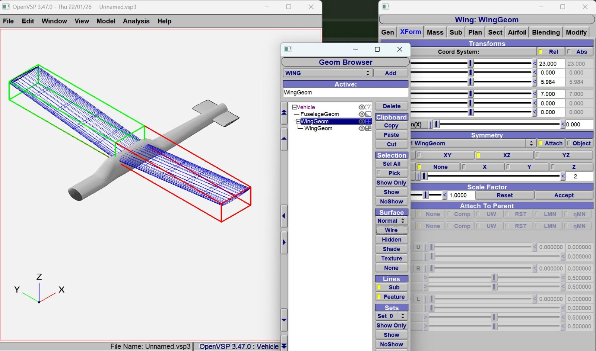
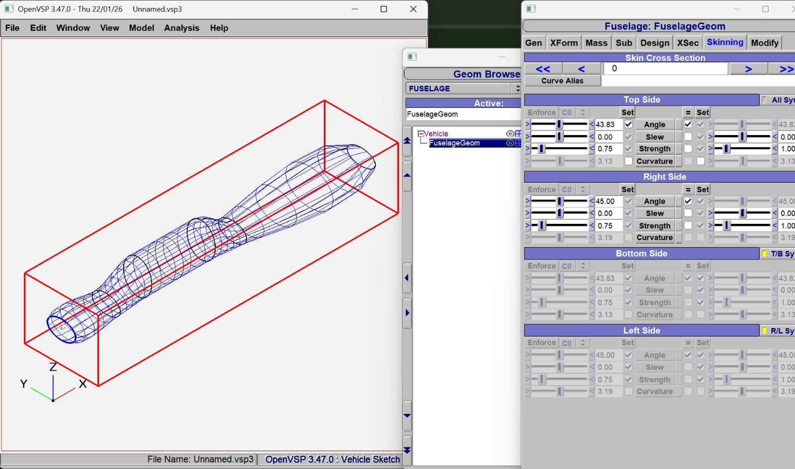

# Fixed-Wing RC Aircraft – OpenVSP Model

A conceptual fixed-wing aircraft I modelled in **OpenVSP** (January 2026). The model includes:
- a shaped fuselage
- a symmetric main wing
- a horizontal and vertical tail
- a three-blade tractor propeller

| Wing setup | Fuselage skinning |
|---|---|
|  |  |
